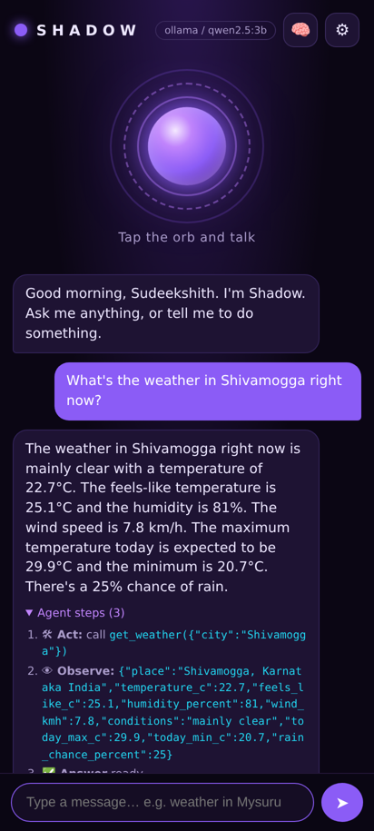
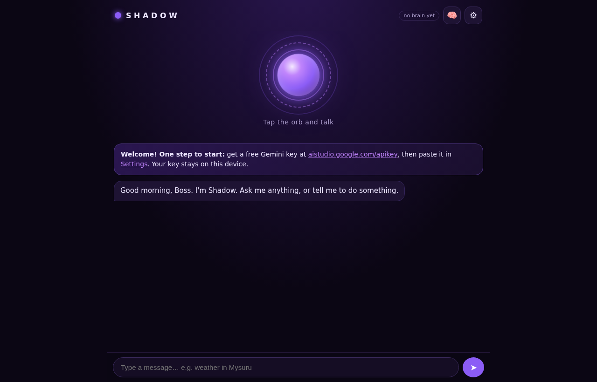

<div align="center">


# Shadow – Personal AI Agent

**A free, open-source voice AI agent that runs in your browser.**
Talk to it. It *thinks*, picks a tool, acts, and answers out loud.

[](https://acharyasudeekshith18-boop.github.io/shadow-ai-agent/)
[](LICENSE)
[](https://acharyasudeekshith18-boop.github.io/shadow-ai-agent/)
[](#-run-the-tests)

**Live:** https://acharyasudeekshith18-boop.github.io/shadow-ai-agent/

</div>

<p align="center">
  
  &nbsp;&nbsp;
  
</p>

---

## ✨ Features

- 🎙️ **Voice in, voice out:** browser speech recognition that **doesn't cut you off** (it waits until you stop talking), plus a spoken reply with a voice you choose.
- 🧠 **A real AI agent (ReAct loop):** think → choose a tool → act → observe → answer, with the reasoning shown under every reply ("Agent steps").
- 🛠️ **14 tools:** weather (Open-Meteo), Wikipedia, web search (DuckDuckGo + Wikipedia), calculator (safe, no `eval`), time/date, open websites, play YouTube, reminders (with notifications), notes, remember/forget facts, device battery info.
- 💾 **Memory:** short-term chat history plus long-term facts ("remember my birthday is 12 March"), saved on your device.
- 🔁 **Free AI brains with automatic fallback:** Google **Gemini** (free key) → **Groq** (free key) → **Ollama** (runs on your laptop, no key, offline).
- 📱 **Installable app (PWA):** "Install" / "Add to Home screen" from Chrome on Android or desktop.
- 🗣️ **Wake word** (optional): say "Hey Shadow" while the page is open.
- 🔒 **Your key stays yours:** stored only in your browser (localStorage). There are **no keys in this repo**.
- 🐍 **Optional Python backend** (FastAPI) in [`backend/`](backend/) that runs the same agent on a server.

## 🚀 Use it now (no install)

1. Open **https://acharyasudeekshith18-boop.github.io/shadow-ai-agent/** in **Chrome** (Android or desktop) or Edge.
2. Get a **free Gemini API key**:
   1. Go to **https://aistudio.google.com/apikey** and sign in with your Google account.
   2. Click **Create API key** and copy it.
3. In Shadow tap **⚙ Settings**, paste the key, and tap **Save** (then **Test my key** if you like).
4. Tap the glowing orb and talk, or type below.

> Optional: add a free **Groq** key (https://console.groq.com/keys) as a backup brain for when Gemini's free daily limit is reached.

**Install as an app:** in Chrome open the ⋮ menu → **Install app** / **Add to Home screen**.

## 💻 Download / run locally

```bash
# 1. Get the code (or click Code → Download ZIP on GitHub and unzip it)
git clone https://github.com/acharyasudeekshith18-boop/shadow-ai-agent.git
cd shadow-ai-agent

# 2. Serve the folder (any static server works; the mic needs http://localhost or https)
python -m http.server 8000
# then open http://localhost:8000
```
Opening `index.html` by double-click won't work fully, because browsers block ES modules and the mic on `file://`. Use a local server as above.

### Fully offline with Ollama (no key)
1. Install Ollama from https://ollama.com and run `ollama pull qwen2.5:3b`
2. Start it so the browser may talk to it: `OLLAMA_ORIGINS=* ollama serve` (Windows PowerShell: `$env:OLLAMA_ORIGINS="*"; ollama serve`)
3. In Settings tick **Use Ollama on this computer**. Small local models are slower and less accurate than Gemini.

## 🧩 How it works

```
 You ──voice/text──► voice.js ──► agent.js ──► llm.js ──► Gemini / Groq / Ollama
                                   │   ▲
                       tool call   ▼   │  observation
                                 tools.js ──► Open-Meteo, Wikipedia, DuckDuckGo, browser
                                   │
                                memory.js (localStorage)
```

| File | Job |
|---|---|
| `js/agent.js` | The ReAct agent loop and the system prompt |
| `js/llm.js` | Talks to Gemini (native function calling) and Groq/Ollama (OpenAI format), with fallback and retry |
| `js/tools.js` | The 14 tools, each with a JSON-Schema description |
| `js/memory.js` | Chat history, facts, notes and reminders in localStorage |
| `js/voice.js` | Speech recognition (no cut-offs), speech synthesis, wake word |
| `js/app.js` | The UI: orb states, chat bubbles, agent steps, settings |
| `sw.js`, `manifest.webmanifest` | Make it an installable PWA |
| `backend/` | Optional Python FastAPI version (prompt-based JSON ReAct) |

## 🧪 Run the tests

```bash
npm test                      # 33 unit tests, Node 18+ (no npm install needed)
node tests/live/live-tools.mjs   # calls the real free APIs
node tests/live/ollama-e2e.mjs   # full agent run with a local Ollama model
cd backend && pip install -r requirements.txt && pytest -q   # 11 backend tests
```

## 🤝 Contributing

Contributions are welcome. Read [CONTRIBUTING.md](CONTRIBUTING.md). Adding a new tool is the easiest first contribution.

## 📄 License

[MIT](LICENSE) © 2026 Sudeekshith. Free to use, copy, modify and share.

Built as a BCA final-year project (Kuvempu University).
